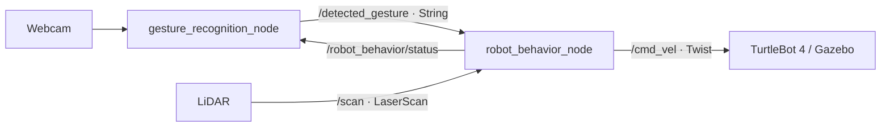

# Bài 6 — Điều khiển TurtleBot 4 bằng cử chỉ tay

**Non-verbal Human–Robot Interaction Using Hand Gesture Recognition**

Nhận diện cử chỉ bằng webcam laptop với **OpenCV + MediaPipe**, truyền kết
quả qua **ROS 2 Humble** và điều khiển **TurtleBot 4 trong Ignition Gazebo**.
Repository này dành riêng cho Bài 6, không cần Nav2 hoặc bản đồ.

## Chức năng

| Cử chỉ | Hành vi |
|---|---|
| Vẫy tay — Wave | Chọn hành vi xoay trái–phải để chào |
| Một ngón — Pointing Up | Chọn tiến–lùi 4 chu kỳ, tổng 8 chặng |
| Hai ngón — Victory | Chọn di chuyển một vòng tròn |
| Ngón cái — Thumbs Up | Xác nhận và chạy hành vi đã chọn |
| Xòe tay — Open Palm | Dừng ngay và xóa lựa chọn |
| Nắm tay — Closed Fist | Hủy hành vi, trở về chờ |

- Chỉ chạy sau xác nhận; lựa chọn được giữ tối đa 5 giây.
- Lọc ổn định tư thế và không kích hoạt lặp khi giữ nguyên cử chỉ.
- Mất tay khi đang chạy hoặc mất tín hiệu quá 0,8 giây thì dừng.
- LiDAR kiểm tra toàn hướng; thiếu scan hoặc có vật gần thì hủy.
- Webcam hiển thị landmark, nhãn, điểm tin cậy và trạng thái robot.
- Sân mô phỏng rộng 10×10 m; chuyển động dùng đồng hồ mô phỏng,
  watchdog dùng đồng hồ thời gian thực.

## Kiến trúc



MediaPipe phân loại 5 tư thế tĩnh. Wave được suy ra từ chuyển động tâm lòng
bàn tay qua nhiều khung hình, không phải lớp mô hình tự huấn luyện.

## Yêu cầu

- Ubuntu 22.04, Python 3.10, ROS 2 Humble.
- TurtleBot 4 Simulator / Ignition Fortress.
- Webcam laptop hoặc USB và desktop đồ họa.

## Cài đặt

```bash
sudo apt update
sudo apt install ros-humble-turtlebot4-simulator \
  ros-humble-rmw-cyclonedds-cpp ros-humble-joint-state-publisher \
  ros-humble-xacro python3-colcon-common-extensions python3-venv git

git clone https://github.com/langvanhuy1208/TurtleBot-4_t6.git ~/tb4_bai6
cd ~/tb4_bai6
/usr/bin/python3 -m venv --system-site-packages .venv-gesture
source .venv-gesture/bin/activate
python -m pip install -r requirements-gesture.txt
python scripts/download_gesture_model.py \
  --output models/gesture_recognizer.task

source /opt/ros/humble/setup.bash
colcon build --symlink-install --packages-select tb4_simplesimu
```

Tên repository là `TurtleBot-4_t6`, tên package ROS giữ là `tb4_simplesimu`.
Hãy build trong checkout này và source đúng `install/setup.bash` của nó.
MediaPipe chạy bằng Python venv để dùng chung thư viện ROS hệ thống.

## Chạy và thử bằng tay

Máy hiện tại: `/home/huy/tb4_simplesimu/release/TurtleBot-4_t6`.
Xem **[hướng dẫn chạy thủ công bằng 3 terminal](CHAY_THU_CONG.md)**.

```bash
cd ~/tb4_bai6
./scripts/run_bai6_live.sh
```

Script mở Gazebo, webcam và node điều khiển. Chờ khoảng 20 giây để robot
và LiDAR sẵn sàng, dock được xóa. Nếu dùng webcam khác, ví dụ video2:

```bash
./scripts/run_bai6_live.sh 2
```

1. Giơ một ngón hoặc hai ngón; chờ trạng thái **SELECTED**.
2. Đổi sang ngón cái trong 5 giây; robot chuyển sang **RUNNING**.
3. Giữ một tay trong khung hình khi chạy; xòe tay để dừng, nắm tay để hủy.
4. Vẫy tay rồi xác nhận bằng ngón cái để robot chào.

Không cần bàn phím lái robot. Ctrl+C ở terminal chạy script để đóng các
tiến trình. Không bật đồng thời teleop hoặc node khác publish `/cmd_vel`.

Log ở `log/bai6_live/`. Script mặc định dùng ROS domain 86 và Cyclone DDS
trên loopback để tách phiên mô phỏng khỏi các robot khác trên mạng.

## Kiểm chứng

- **19/19 kiểm thử logic đạt**; package build thành công.
- Kiểm thử tích hợp ROS: chọn, xác nhận, dừng, timeout cử chỉ/scan, vật cản.
- Đã mở webcam thật và nhận cử chỉ, chạy robot trong Gazebo.
- Đã kiểm tra 4 chu kỳ tiến–lùi, vòng tròn và chào qua nhãn thử.
- Vòng tròn đo bằng odometry: **6,273 rad**, lệch điểm đầu khoảng **0,015 m**.

Tiến–lùi chạy theo thời gian, chưa có phản hồi vị trí; lần đo kết thúc lệch
điểm đầu khoảng 0,519 m. Đây không phải bộ bám quỹ đạo chính xác.
Kiểm thử bằng nhãn thử không thay thế demo đầy đủ bằng webcam thật.

```bash
python3 -m unittest discover -s tests -v
source /opt/ros/humble/setup.bash
ROS_DOMAIN_ID=87 ROS_LOCALHOST_ONLY=1 python3 tests/ros_gesture_smoke.py
.venv-gesture/bin/python tests/mediapipe_smoke.py models/gesture_recognizer.task
```

## Tài liệu và báo cáo

- [Hướng dẫn chi tiết, tham số và xử lý lỗi](docs/bai6/README.md).
- [Báo cáo PDF](docs/bai6/bao_cao.pdf).
- [Kết quả kiểm chứng](docs/bai6/validation.md).
- [Số liệu chuyển động Gazebo](docs/bai6/gazebo_test_results.json).
- [Phiếu ghi thực nghiệm và nội dung cần bổ sung](docs/bai6/ket_qua_thuc_nghiem.md).

Video Google Drive công khai và thống kê độ chính xác nhận diện chưa có.
Thông tin sinh viên và các mục còn trống trong báo cáo cần điền trước khi nộp.

## Cấu trúc

```text
scripts/       Hai node ROS, logic cử chỉ, tải mô hình, script chạy demo
launch/        Khởi chạy mô phỏng và hệ thống điều khiển
config/        Ngưỡng nhận diện, vận tốc, watchdog, cấu hình DDS
worlds/        Sân mô phỏng Bài 6
urdf/          Mô hình TurtleBot 4 và cấu hình LiDAR
tests/         Kiểm thử logic, ROS và MediaPipe
docs/bai6/     Hướng dẫn, báo cáo PDF và kết quả kiểm chứng
```

## Tham khảo và giấy phép

- [MediaPipe Gesture Recognizer](https://ai.google.dev/edge/mediapipe/solutions/vision/gesture_recognizer/python).
- [OpenCV](https://docs.opencv.org/4.x/).
- [TurtleBot 4](https://turtlebot.github.io/turtlebot4-user-manual/software/simulation.html).

Mã nguồn theo [Apache License 2.0](LICENSE). Các tệp dựa trên TurtleBot 4
giữ thông tin bản quyền gốc của Clearpath Robotics.
