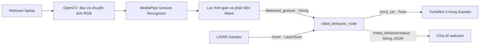

# Bài 6 — Điều khiển TurtleBot 4 bằng cử chỉ tay

Một bài thực hành mới dùng webcam laptop, MediaPipe Tasks và ROS 2 Humble.
Hai node của bài này hoạt động độc lập với các node YOLO, SLAM và Nav2 cũ.
Mã nguồn nằm trong package `tb4_simplesimu` để dùng lại mô hình TurtleBot 4
và bridge Ignition đã có. Không cần bản đồ hay Nav2.

## 1. Kiến trúc và nguyên lý



`gesture_recognition_node` đọc ảnh 640×480, lật ảnh như gương, chuyển BGR
sang RGB và gọi `recognize_for_video()` với timestamp mili giây tăng dần.
MediaPipe trả về nhãn, điểm tin cậy và 21 landmark. Chương trình chỉ chấp
nhận đúng một bàn tay và điểm tin cậy ≥ 0,65. Hai tay, không có tay hoặc
nhãn ngoài danh sách sẽ phát `NONE`. Tư thế chọn/xác nhận cần ổn định 0,35 s.

MediaPipe có sẵn `Pointing_Up`, `Victory`, `Thumb_Up`, `Open_Palm`,
`Closed_Fist`; `Wave` được suy ra bằng quy tắc thời gian, không phải nhãn
AI gốc. Tâm lòng bàn tay là trung bình landmark 0, 5, 9, 13, 17.
Vẫy cần 3 lượt ngang luân phiên (phải–trái–phải hoặc ngược lại), mỗi lượt
ít nhất 10% chiều rộng ảnh, trong 1,6 s. Điểm hiển thị khi vẫy là điểm
Open Palm của mô hình, không phải xác suất riêng của Wave.

`robot_behavior_node` có ba trạng thái: `IDLE → SELECTED → RUNNING`.
Chọn chỉ lưu hành vi; Thumbs Up mới chạy. Khi hoàn thành, dừng/hủy hoặc
lỗi an toàn, lựa chọn bị xóa và không tự chạy lại. Node xuất vận tốc 20 Hz
bằng timer, không dùng `sleep()` chặn callback.

| Cử chỉ | Nhãn topic | Tác dụng |
|---|---|---|
| Vẫy tay | `Wave` | Chọn GREET; xác nhận rồi robot xoay trái–phải chào hai lần |
| Một ngón trỏ hướng lên | `Pointing_Up` | Chọn BACK_FORTH: 4 chu kỳ tiến rồi lùi |
| Hai ngón hình V | `Victory` | Chọn CIRCLE: một vòng tròn |
| Ngón cái hướng lên | `Thumb_Up` | Xác nhận lựa chọn hiện có |
| Xòe bàn tay | `Open_Palm` | Dừng và xóa lựa chọn ngay khi nhận diện đạt ngưỡng |
| Nắm tay | `Closed_Fist` | Hủy và trở về IDLE |

Để đáp ứng quy định “chỉ thực hiện sau xác nhận”, cả chào bằng Wave cũng
cần Thumbs Up. Open Palm ban đầu có tác dụng dừng; nếu tiếp tục vẫy đủ
mẫu, bộ nhận diện chuyển sang Wave và giữ nhãn này cho tới khi đổi tư thế.
Sau khi xác nhận, xòe tay trở lại sẽ dừng bình thường. Không có chuyển động
chào tự phát trong lúc đang chạy hành vi khác.

## 2. Cài đặt và build

Môi trường: Ubuntu 22.04, Python **3.10**, ROS 2 Humble và Ignition Fortress.
Các lệnh dưới đây giả sử repo ở `~/tb4_simplesimu`.

```bash
sudo apt update
sudo apt install ros-humble-turtlebot4-simulator ros-humble-turtlebot4-navigation \
  ros-humble-rclpy ros-humble-geometry-msgs ros-humble-sensor-msgs \
  ros-humble-std-msgs python3-colcon-common-extensions python3-venv

cd ~/tb4_simplesimu
/usr/bin/python3 -m venv --system-site-packages .venv-gesture
source .venv-gesture/bin/activate
python -m pip install -r requirements-gesture.txt
python scripts/download_gesture_model.py \
  --output "$HOME/.cache/tb4_gesture/gesture_recognizer.task"

source /opt/ros/humble/setup.bash
colcon build --symlink-install --packages-select tb4_simplesimu
source install/setup.bash
```

Mô hình tải từ Google, phiên bản float16/1. Không tự tải khi node khởi chạy.
Venv dùng `--system-site-packages` để thấy `rclpy` của ROS. Khi gọi node
nhận diện, dùng trực tiếp Python của venv như lệnh ở phần 3: executable
ROS cài bởi CMake dùng Python hệ thống theo shebang.

## 3. Chạy demo

Trên máy hiện tại đã chuẩn bị môi trường thử, mở cả Gazebo, webcam và
điều khiển bằng một lệnh:

```bash
cd ~/tb4_simplesimu
./scripts/run_bai6_live.sh
```

Script dùng domain ROS 86 mặc định, cấu hình Cyclone DDS loopback đủ
participant cho simulator và ghi log tại `log/bai6_live/`. Camera khác:
`./scripts/run_bai6_live.sh 2`. Ctrl+C dừng cả hệ thống. Chờ khoảng 20 giây
để xóa dock. Script ưu tiên venv, rồi thư viện thử trong `/tmp`; sau khi
khởi động lại máy, cài venv theo phần 2 nếu cần. Sân demo giữ IMU và LiDAR
15 Hz, bỏ render camera robot, IR/cliff để giảm tải; webcam laptop vẫn
nhận diện bình thường.

Các lệnh riêng bên dưới phù hợp khi muốn quan sát từng tiến trình.

Terminal 1, mở sân 10×10 m, robot ở giữa và bốn tường bao:

```bash
source /opt/ros/humble/setup.bash
source ~/tb4_simplesimu/install/setup.bash
ros2 launch tb4_simplesimu gesture_sim.launch.py
```

Chờ robot xuất hiện, `/scan` hoạt động và log xóa `standard_dock` trả về
`data: true` sau khoảng 20 s. Đóng mọi teleop, Nav2 và node điều khiển cũ.
Chỉ để `robot_behavior_node` publish `/cmd_vel` trong demo.

Terminal 2, chạy bộ điều khiển:

```bash
source /opt/ros/humble/setup.bash
source ~/tb4_simplesimu/install/setup.bash
ros2 launch tb4_simplesimu gesture_control.launch.py start_camera:=false
```

Terminal 3, chạy webcam bằng đúng Python đã cài MediaPipe:

```bash
cd ~/tb4_simplesimu
source /opt/ros/humble/setup.bash
source install/setup.bash
.venv-gesture/bin/python scripts/gesture_recognition_node.py --ros-args \
  --params-file config/gesture.yaml \
  -p model_path:="$HOME/.cache/tb4_gesture/gesture_recognizer.task" \
  -p camera_index:=0
```

Nếu đã cài MediaPipe và OpenCV vào Python hệ thống, có thể thay terminal
2 và 3 bằng `ros2 launch tb4_simplesimu gesture_control.launch.py`.
Không cần cài vào Python hệ thống khi dùng cách venv phía trên.

Kiểm tra trước demo (các lệnh này chỉ quan sát, không điều khiển):

```bash
ros2 topic info /cmd_vel --verbose
ros2 topic echo /detected_gesture
ros2 topic echo /robot_behavior/status
ros2 topic hz /scan
```

Để kiểm tra đường vận tốc ở bước chuẩn bị, dùng Pointing Up → Thumb Up
và quan sát `/cmd_vel`: trước xác nhận là 0, sau xác nhận `linear.x=0.15`.
Open Palm phải đưa vận tốc về 0. Không cần dùng bàn phím lái robot.

Giữ đúng một tay trong khung hình suốt hành vi, có thể giữ Thumbs Up.
Khi đang chạy, đưa tay ra ngoài sẽ **hủy**, không tạm dừng để chạy tiếp. Chọn và xác nhận
lại nếu muốn chạy lại. Khi chuyển tư thế, hệ thống cho phép giai đoạn
`TRANSITION` ngắn nhưng không gia hạn watchdog; nếu AI mất nhận diện
(`NONE`) thì dừng ngay. Giữ một nhãn không tạo nhiều lần kích hoạt.
Riêng trạng thái SELECTED chưa có chuyển động: lựa chọn được giữ tối đa
5 giây để đổi tư thế sang Thumbs Up qua các khung hình không nhận diện.

Nếu robot có namespace, dùng `cmd_vel_topic:=/robot1/cmd_vel
scan_topic:=/robot1/scan` cho launch điều khiển. Các node cử chỉ vẫn dùng
topic toàn cục của bài này.

## 4. Thông số chuyển động và an toàn

Trong `config/gesture.yaml`:

| Thông số | Mặc định | Ý nghĩa |
|---|---:|---|
| `confidence_threshold` | 0,65 | Ngưỡng điểm phân loại |
| `hold_seconds` | 0,35 s | Thời gian giữ tư thế chọn/xác nhận |
| `signal_timeout` | 0,8 s | Không nhận cử chỉ hợp lệ → dừng |
| `linear_speed` | 0,15 m/s | Vận tốc tiến/lùi và vòng tròn |
| `leg_seconds` | 2 s | Mỗi chặng tiến hoặc lùi, danh định 0,30 m |
| `circle_radius` | 0,60 m | Bán kính danh định; ω=v/R=0,25 rad/s |
| `angular_speed` | 0,50 rad/s | Tốc độ xoay chào |
| `scan_timeout` | 0,8 s | Không có scan mới → dừng |
| `obstacle_distance` | 0,45 m | Khoảng cách LiDAR nhỏ nhất cho phép |

Tiến–lùi 4 lần được định nghĩa là **4 chu kỳ**, tức 8 chặng, khoảng 16 s
theo đồng hồ mô phỏng. Vòng tròn mất khoảng 25,13 s mô phỏng; khi Gazebo
chạy chậm, thời gian thực sẽ dài hơn. Đây là điều khiển vận tốc theo thời gian,
không phải bám quỹ đạo bằng odometry: độ chính xác phụ thuộc tốc độ mô
phỏng và động học. Không khẳng định robot trở lại chính xác vị trí đầu.

Open Palm và Closed Fist không chờ lọc 0,35 s. Khi nhận được, callback
publish Twist bằng 0 ngay. LiDAR kiểm tra toàn bộ hướng, kể cả phía sau
khi lùi; tối thiểu 80% tia phải hợp lệ hoặc +inf. Thiếu scan, scan lỗi hoặc
có vật gần thì hủy hành vi và yêu cầu chọn lại. +inf được hiểu là không
có phản hồi trong tầm đo. Đây là lớp dừng theo khoảng cách, không phải
thuật toán tránh vật cản hoặc bảo đảm chống mọi va chạm.

Watchdog dùng thời gian đơn điệu thực, không phụ thuộc `/clock` và vẫn
phát lệnh dừng khi Gazebo bị pause. Không tự tiếp tục sau khi mất tín hiệu.
Thời lượng các pha chuyển động dùng `/clock` để tránh cắt ngắn quỹ đạo
khi tốc độ mô phỏng thấp. Hai đồng hồ có nhiệm vụ riêng.
Nếu chính tiến trình điều khiển bị SIGKILL, nó không thể publish lệnh dừng;
khi đó cần timeout vận tốc của bộ điều khiển robot bên dưới. Demo cần
kiểm tra điều kiện này trên simulator thực tế.

## 5. Kịch bản quay video, không dùng bàn phím lái

1. Bố trí cửa sổ Gazebo và webcam cạnh nhau; thấy rõ tay, nhãn, điểm và trạng thái.
2. Pointing Up: trạng thái SELECTED, robot đứng yên. Thumb Up: chạy đủ 4 chu kỳ.
3. Victory → Thumb Up: chạy hết một vòng, giữ tay trong khung hình.
4. Wave → Thumb Up: robot chào; cho thấy cả bước SELECTED trước xác nhận.
5. Chọn một hành vi, xác nhận, xòe tay giữa chừng: robot dừng.
6. Chạy lại, nắm tay: robot hủy, về IDLE. Thumb Up đơn lẻ không chạy lại.
7. Chạy lại rồi rút tay: robot dừng. Quay cả cửa sổ trạng thái để thấy lý do.
8. Giữ Thumb Up sau khi hoàn tất: robot không chạy lặp lại.

Quay bằng công cụ ghi màn hình của Ubuntu hoặc OBS. Không chèn kết quả
giả hoặc dùng dữ liệu kiểm thử tự động thay cho video webcam thật.

## 6. Kiểm thử và báo cáo

```bash
cd ~/tb4_simplesimu
python3 -m unittest discover -s tests -v
source /opt/ros/humble/setup.bash
python3 tests/ros_gesture_smoke.py
```

Kiểm thử ROS dùng topic `/bai6_test/*`, không gửi lệnh tới robot thực.
Bộ test mô phỏng scan và cử chỉ để kiểm tra đường topic và watchdog.
Nó không chứng minh chất lượng nhận diện webcam hoặc độ chính xác quỹ đạo.
Kết quả kiểm chứng đã chạy: [validation.md](validation.md).

Kiểm tra MediaPipe và file mô hình trước khi mở webcam:

```bash
.venv-gesture/bin/python tests/mediapipe_smoke.py \
  "$HOME/.cache/tb4_gesture/gesture_recognizer.task"
```

- `docs/bai6/bao_cao.pdf`: báo cáo kỹ thuật, có ghi rõ phần thực nghiệm chờ bổ sung.
- `docs/bai6/build_report.py`: nguồn tạo PDF, sửa thông tin sinh viên và link tại đây.
- `docs/bai6/ket_qua_thuc_nghiem.md`: bảng ghi số liệu và vị trí ảnh cần chụp.

Tạo lại PDF sau khi sửa nguồn: `python3 docs/bai6/build_report.py` (cần
`python3-reportlab` và `fonts-dejavu-core` từ apt).

Sau khi quay thật, upload video lên Google Drive, đặt “Anyone with the
link”, thử bằng cửa sổ ẩn danh; đẩy repository lên GitHub Public và điền
hai URL vào báo cáo. Không để thông tin sinh viên/link còn trống khi nộp.
Video, ảnh webcam thực nghiệm và URL công khai chưa được tạo tự động.

## 7. Lỗi thường gặp

- Không thấy webcam: kiểm tra `ls /dev/video*`, quyền nhóm `video`, ứng dụng
  khác đang dùng camera; đổi `camera_index:=2` nếu thiết bị phù hợp là video2.
- Không có MediaPipe: dùng `.venv-gesture/bin/python` như phần 3.
- Không có `/scan`: kiểm tra bridge, scan topic và Gazebo đã chạy; hệ thống
  chủ động giữ vận tốc 0 khi chưa có dữ liệu LiDAR.
- LiDAR đọc khoảng cách gần bằng nhau mọi hướng: kiểm tra robot description
  và hiện tượng vỏ LiDAR tự che tia; launch mới dùng bản mô hình đã sửa trong repo.
- Không chạy dù có xác nhận: đọc `/robot_behavior/status`; kiểm tra dock đã
  xóa, robot không còn docked, vùng quanh robot trống và không có publisher khác.
- Wave khó nhận: giữ bàn tay mở, vẫy ngang rõ hơn 10% bề ngang ảnh, 3 lượt
  trong 1,6 s; tay quá nhỏ/ánh sáng yếu sẽ gây NONE và làm dừng.

## 8. Tài liệu chính thức

- [MediaPipe Gesture Recognizer Python](https://ai.google.dev/edge/mediapipe/solutions/vision/gesture_recognizer/python)
- [Mô hình và các nhãn cử chỉ](https://ai.google.dev/edge/mediapipe/solutions/vision/gesture_recognizer)
- [OpenCV VideoCapture](https://docs.opencv.org/4.x/d8/dfe/classcv_1_1VideoCapture.html)
- [TurtleBot 4 Simulation](https://turtlebot.github.io/turtlebot4-user-manual/software/simulation.html)

## 9. Các câu cần giải thích được khi bảo vệ

1. Vì sao dùng VIDEO mode, và tại sao timestamp phải tăng?
2. Phân biệt nhãn cử chỉ AI với bộ nhận diện Wave theo thời gian.
3. Vai trò của landmark, ngưỡng tin cậy và thời gian giữ tư thế.
4. Vì sao chọn hành vi khác với thực thi; trạng thái được xóa khi nào?
5. `Twist.linear.x`, `Twist.angular.z` có đơn vị gì? Vì sao R=v/ω?
6. Vì sao timer/callback tốt hơn vòng lặp chuyển động có sleep?
7. Phân biệt mất bàn tay, mất node nhận diện và mất node điều khiển.
8. Vì sao kiểm tra scan cả phía sau và không tự tiếp tục sau lỗi?
